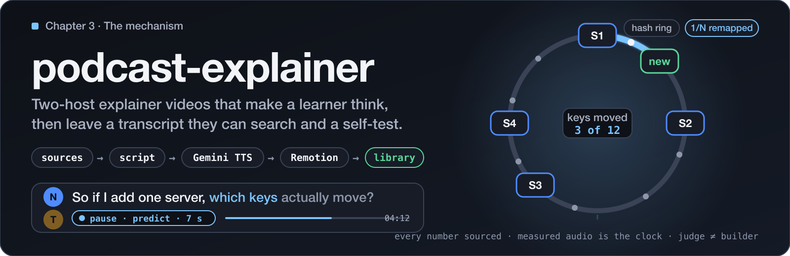

# podcast-explainer

[](https://github.com/Shavvimal/podcast-explainer/actions/workflows/ci.yml)
[](https://github.com/Shavvimal/podcast-explainer/releases)
[](LICENSE)


<p align="center">
  
</p>

**Why this exists.** A clear, fluent explainer video raises confidence without raising learning. The effects
that do raise learning are known: retrieval, prediction before explanation, self-explanation, a misconception
voiced and broken, spaced self-testing. Almost no generated video uses them, because they cost structure:
pauses that hold, questions that come before answers, numbers that trace to a source, a diagram that changes
state with every claim. This skill makes an agent pay that cost. It turns a topic, a document or a URL into a
two-host podcast-style video for one learner, then files the episode in a searchable transcript library with
flashcards, a teach-back sheet and a self-test, so the learner can check what they understood a week later.

Audio is Gemini TTS, one call per dialogue turn. Video is Remotion, driven by the measured audio: no duration,
frame count or timestamp is ever typed by hand. Every step writes one JSON file, and a script validates it
before the next costly step. Three human gates (outline, look, watch) sit before every paid call. An
independent judge agent scores the final video against a rubric, and a blind agent restates the concept from
the frames and spoken text alone.

It ships as a Claude Code plugin with one skill, `podcast-explainer-video`.

## How it works

```
brief.json -> facts.json -> outline.json -> script.json -> scenes.json -> audio -> timing.json
   intake      sourced      GATE 1          validated      GATE 2        Gemini    whisper.cpp
               claims       (outline)       dialogue       (look)        TTS       word timing

-> episode.json -> episode.mp4 -> qc/ (judge + restate) -> GATE 3 -> transcript, captions,
   manifest        Remotion       stills, rubric, build id   (watch)    chapters, library/, learn/
```

- **Every claim sourced.** Every number traces to `facts.json` with a verbatim quote, or to arithmetic on
  sourced facts, or carries an "Example data" label. The validator fails a script that states a number from
  memory.
- **Understanding, not fluency.** A prediction pause in the cold open, one retrieval pause every 5 to 6
  minutes, an explain-back before the host explains, a misconception voiced then broken. The validator
  hard-fails a script that skips them.
- **One persistent concept world.** Each spoken claim gets a visible state change in one diagram that lives
  for the whole episode. Cards appear only for the title, the recap and the self-check.
- **Measured audio is the clock.** whisper.cpp gives word timings per turn; `build_manifest.py` turns them
  into scene anchors and caption pages. Loudness is normalised to a stated target and checked by `qc.py`.
- **The judge is not the builder.** `qc.py` writes a brief for a read-only judge agent and a blind brief for
  a restater. Their scores and the build identity (a digest over every input) go into `qc/scores.json`.
- **Searchable for ever.** Each episode becomes one markdown transcript with `[mm:ss]` lines, captions
  (SRT and VTT), embedded chapters, a library index, flashcards (CSV and markdown), a teach-back sheet and a
  self-test with one held-out question. `rg`, `qmd` and `search.py` read the same files.

Three depths: `quick` (about 6 minutes, 5 segments), `standard` (about 12 minutes, 8 segments) and `deep`
(20 to 35 minutes as 2 or 3 parts, 5 or more sources, 3 per load-bearing claim).

## Requirements

- [Claude Code](https://code.claude.com/) for the plugin. The scripts also run on their own.
- Python 3.10 or newer. The scripts use the standard library only.
- Node 20 or newer, with `npm` and `npx`, for Remotion and `align.mjs`.
- `ffmpeg` and `ffprobe` on the PATH.
- A Gemini API key with access to `gemini-3.8-flash-tts` on the Gemini Developer API. Set `GEMINI_API_KEY`
  in your shell, or put the line `GEMINI_API_KEY=...` in `~/.config/podcast-explainer/env` (or in the file
  named by `PODCAST_EXPLAINER_ENV_FILE`). The key is read in code and never printed; see
  [SECURITY.md](SECURITY.md).
- Disk for whisper.cpp and its model (about 500 MB, downloaded once on first use) and for Remotion's bundled
  Chrome.
- macOS `say` is optional: it gives a free scratch voice for drafts (`--scratch`).

Remotion is free for individuals and companies of up to 3 people; a larger company needs a licence. Read
[DISCLAIMER.md](DISCLAIMER.md) before rendering inside a company.

## Installation

As a Claude Code plugin, from the marketplace in this repository:

```
/plugin marketplace add Shavvimal/podcast-explainer
/plugin install podcast-explainer@podcast-explainer
/reload-plugins
```

The skill is then `/podcast-explainer:podcast-explainer-video`, and Claude picks it on its own when you ask
for an explainer video, a two-host explanation, a deep dive in parts, or where a past episode explained
something. To update later: `/plugin marketplace update podcast-explainer`, then start a new session.

Then give it the key, once:

```sh
mkdir -p ~/.config/podcast-explainer
printf 'GEMINI_API_KEY=%s\n' "$YOUR_KEY" > ~/.config/podcast-explainer/env && chmod 600 ~/.config/podcast-explainer/env
```

or export `GEMINI_API_KEY` in your shell, or set `PODCAST_EXPLAINER_ENV_FILE` to a dotenv file you already
keep. Never paste the key into the chat: the skill tells the agent to refuse it.

The first run in a project copies `templates/remotion/` to `explainers/remotion/` and runs `npm install`
there (about 10 seconds plus the download). `preflight.py --warm-whisper` then builds whisper.cpp and
fetches its model, so no paid step waits on a build.

To try a working copy for one session instead, see [DEVELOPING.md](DEVELOPING.md):

```
claude --plugin-dir /path/to/podcast-explainer
```

## Usage

Ask Claude in a project folder:

> Make me a 12-minute explainer on consistent hashing from this document.

> Help me understand p-values as a video. I keep thinking a p-value is the probability the null is true.

> Explain attention in transformers in depth, from first principles.

> That part about table doubling was too fast. I rewrote turn t07. Redo just that segment.

> Where did we explain why the ring moves only 1/N of the keys?

The skill asks at most one intake question, writes `explainers/<slug>/brief.json`, and stops at each gate
with the evidence and the options, recommended option first. Episodes land in `explainers/<slug>/`, the
library in `explainers/library/`, and the learner's work in `explainers/<slug>/learn/`.

To run the scripts without Claude, every one has a `--help` and a docstring. The entry point for the whole
workflow is [`skills/podcast-explainer-video/SKILL.md`](skills/podcast-explainer-video/SKILL.md).

### What an episode costs

| Item | Measured |
|---|---|
| Gemini TTS, `gemini-3.8-flash-tts` | about $0.14 per 10 minutes of speech until 31 Dec 2026, then about $0.27 (Google's pricing page, read 2 Nov 2026) |
| Render, 1080p30, software x264 | about 100 s wall time for an 11-minute episode on an M-series Mac at `--concurrency=16` |
| A retake of one turn | billed again; `tts.py` caches every take by content hash, so an unchanged turn is never re-synthesised |

### Finding something later

```
rg "virtual nodes" explainers/library
python3 skills/podcast-explainer-video/scripts/search.py "virtual nodes" --library explainers/library
```

`search.py` prints the episode, chapter, `[mm:ss]`, speaker, a snippet and a `file://...#t=SECONDS` deep link.
If the library sits in a [qmd](https://github.com/tobi/qmd) collection, `qmd search` and
[cairn](https://github.com/Shavvimal/cairn) find it too.

## Repository layout

| Path | What it holds |
|---|---|
| `skills/podcast-explainer-video/SKILL.md` | The skill: non-negotiables, depth and intake, the 15-step checklist, gates, commands, file map, troubleshooting |
| `skills/podcast-explainer-video/references/` | One file per topic: script and pedagogy rules, learning design, depth ladder, Gemini TTS, manifest, Remotion, visuals, memory palace, QC, library |
| `skills/podcast-explainer-video/scripts/` | `preflight.py`, `validate_script.py`, `tts.py`, `align.mjs`, `fidelity.py`, `build_manifest.py`, `qc.py`, `transcript.py`, `learn.py`, `search.py`, `export_delivery.py`, `write_scores.py`, and `pe_common.py` (shared helpers) |
| `skills/podcast-explainer-video/schemas/` | JSON Schemas for every file the workflow writes |
| `skills/podcast-explainer-video/templates/remotion/` | The Remotion project, copied once per workspace. Pinned versions, sample inputs, one sample episode |
| `skills/podcast-explainer-video/evals/` | Three trigger-and-behaviour scenarios plus sample files |
| `tests/` | 384 unit tests, standard library only. The renderer tests need a Remotion `node_modules` (`PE_REMOTION_DIR`) and skip without one |
| `scripts/check_hygiene.py` | The public-repository scan CI runs on every tracked file |

## Known limits

- The judge agent cannot listen. Audio is scored from numbers (loudness, true peak, fidelity of the ASR
  words to the script). The learner's ear at gate 3 is the final audio check; their note goes in
  `qc/listen.json`.
- `qc/scores.json` cannot prove that independent agents wrote the scores. The verbatim replies only make a
  mismatch visible.
- Whisper mishears names. `brief.json` `lexicon` maps a heard spelling to its term so fidelity does not warn on
  it; a mapping that would hide a meaning change (a number, a negation) is refused.
- Gemini `gemini-3.8-flash-tts` is the only tested model. The fallback `gemini-3.8-flash-lite-tts` works;
  the Cloud Text-to-Speech API does not carry these models.

## Contributing

See [CONTRIBUTING.md](CONTRIBUTING.md) for the rules and [DEVELOPING.md](DEVELOPING.md) for the steps: set up, try a
change in one session, ship it, update your install. `make check` must pass. This repository is public: no personal path,
name, key or private project may appear in a tracked file, and `scripts/check_hygiene.py` enforces the
shapes CI can see.

## Licence

MIT, see [LICENSE](LICENSE). Remotion, Gemini, whisper.cpp and ffmpeg keep their own licences and terms, see
[DISCLAIMER.md](DISCLAIMER.md).
